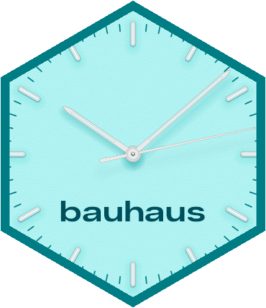
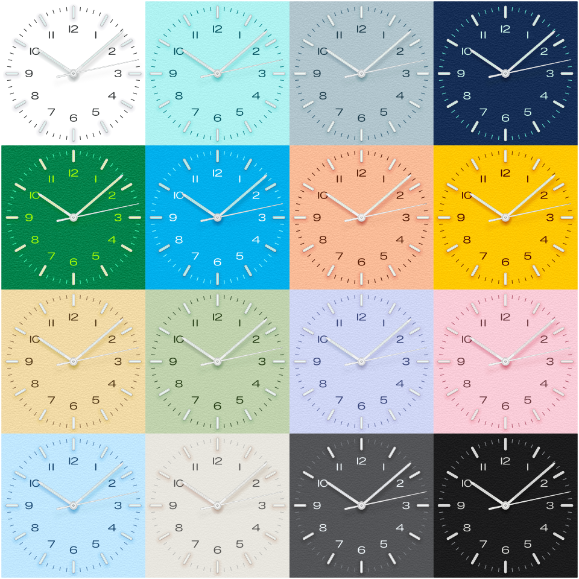
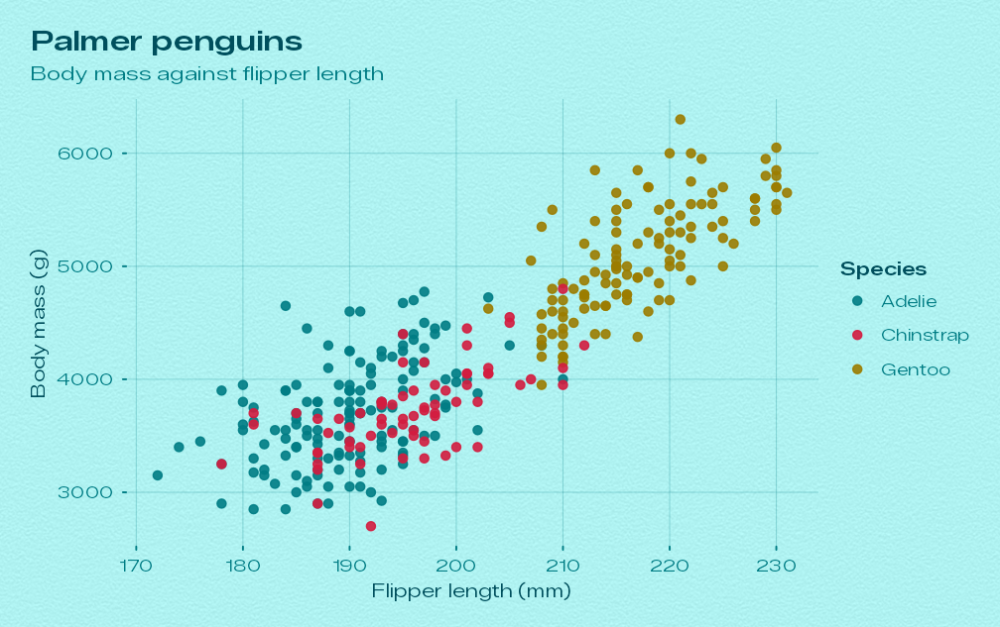
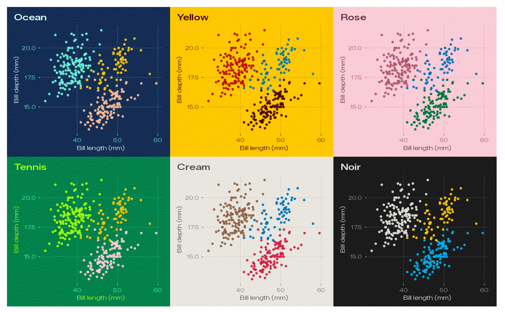
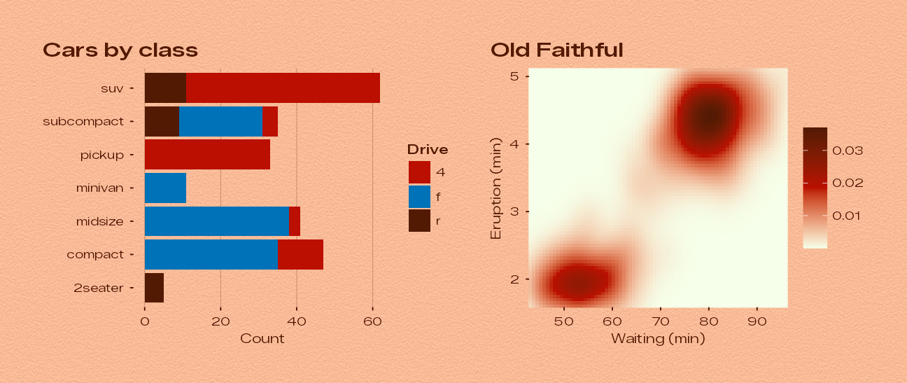
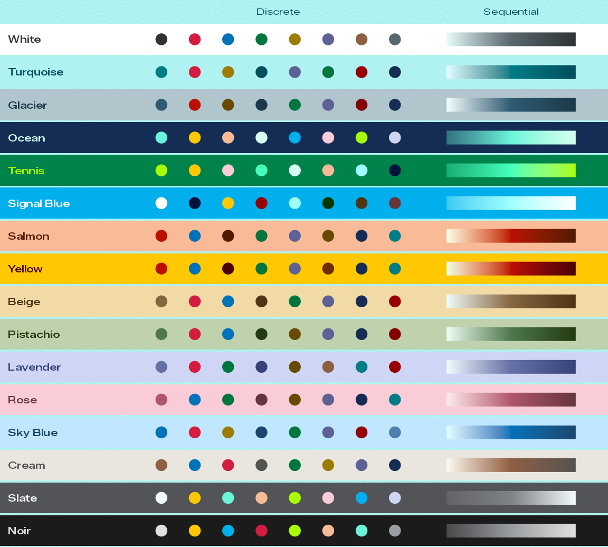
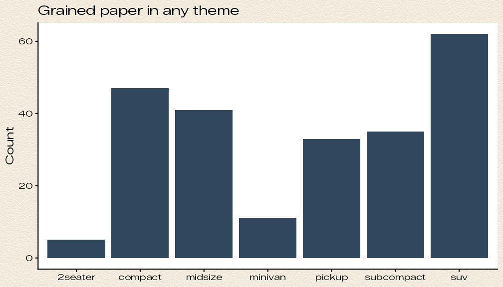
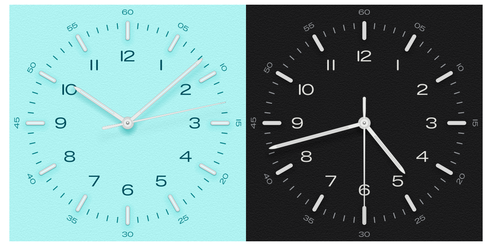

<!-- README.md is generated from README.Rmd. Please edit that file and knit it. -->

# bauhaus 

<!-- badges: start -->

[](https://github.com/ashgreat/bauhaus-clock-ggplot/actions/workflows/R-CMD-check.yaml)
[](https://ashgreat.github.io/bauhaus-clock-ggplot/)
<!-- badges: end -->

**ggplot2 themes from the dials of the Bauhaus Clock screensaver.**

bauhaus brings the sixteen day dials of the Bauhaus Clock macOS
screensaver to ggplot2. Every theme paints the plot on the dial’s paper
plate, complete with the screensaver’s fine paper grain, sets type in
the screensaver’s typeface, and takes its text, grid, geom and palette
colours from the inks, steel, lume and shadow tints measured on that
dial.



<sup>All sixteen dials, drawn with `bauhaus_clock()`.</sup>

- **Sixteen themes**: White, Turquoise, Glacier, Ocean, Tennis, Signal
  Blue, Salmon, Yellow, Beige, Pistachio, Lavender, Rose, Sky Blue,
  Cream, Slate and Noir. Only the day dials are included.
- **The screensaver’s paper grain**, generated with the same algorithm,
  kernel and seed, at the strength measured for each dial.
- **The screensaver’s typeface**, Zalando Sans Expanded, bundled and
  registered automatically.
- **Matching palettes and scales**: an eight-colour discrete palette and
  a sequential ramp per dial, set as the plot’s defaults by each theme.
- **The dial itself**: `bauhaus_clock()` draws the clock face, at any
  time, in any colourway.

See the [website](https://ashgreat.github.io/bauhaus-clock-ggplot/) for
a
[gallery](https://ashgreat.github.io/bauhaus-clock-ggplot/articles/gallery.html)
of every dial and the full documentation.

## Installation

bauhaus needs R 4.1 or later and ggplot2 4.0 or later. Install it from
GitHub:

``` r
# install.packages("pak")
pak::pak("ashgreat/bauhaus-clock-ggplot")

# or
# install.packages("remotes")
remotes::install_github("ashgreat/bauhaus-clock-ggplot")
```

For the bundled typeface to show up, draw with a device that uses
systemfonts, such as [ragg](https://ragg.r-lib.org) (see [Fonts and
devices](#fonts-and-devices)):

``` r
install.packages("ragg")
```

## Quick start

Build a plot as usual and add `theme_bauhaus()`. The default dial is
Turquoise, the screensaver’s own default.

``` r
library(ggplot2)
library(bauhaus)

penguins <- na.omit(palmerpenguins::penguins)

p <- ggplot(penguins, aes(flipper_length_mm, body_mass_g, colour = species)) +
  geom_point(size = 1.8, alpha = 0.9) +
  labs(
    title = "Palmer penguins",
    subtitle = "Body mass against flipper length",
    x = "Flipper length (mm)", y = "Body mass (g)", colour = "Species"
  )

p + theme_bauhaus()
```



Pick any other dial by name, or use its shortcut:

``` r
p + theme_bauhaus("ocean")
p + theme_bauhaus("Signal Blue") # case, spaces and underscores don't matter
p + theme_bauhaus_yellow()
```



## The sixteen dials

| Dial        | Theme                          | Paper     | Numerals  | Track     | Grain σ |
|-------------|--------------------------------|-----------|-----------|-----------|---------|
| White       | `theme_bauhaus("white")`       | `#FFFFFF` | `#303334` | `#292B2B` | none    |
| Turquoise   | `theme_bauhaus("turquoise")`   | `#AFF2F1` | `#004F5D` | `#007C84` | 3.8     |
| Glacier     | `theme_bauhaus("glacier")`     | `#B1C5CD` | `#1B3A49` | `#2E5B73` | 4.8     |
| Ocean       | `theme_bauhaus("ocean")`       | `#152D55` | `#D4FFF0` | `#6AF4D9` | 5.3     |
| Tennis      | `theme_bauhaus("tennis")`      | `#00824B` | `#A7FF01` | `#45FFBB` | 7.8     |
| Signal Blue | `theme_bauhaus("signal_blue")` | `#00AFEC` | `#FFFFFF` | `#9FFFFF` | 4       |
| Salmon      | `theme_bauhaus("salmon")`      | `#F9BB97` | `#531A03` | `#4C1200` | 5.3     |
| Yellow      | `theme_bauhaus("yellow")`      | `#FFC800` | `#4A0305` | `#6E2C00` | 4.45    |
| Beige       | `theme_bauhaus("beige")`       | `#F1DAA6` | `#4F3513` | `#856641` | 5.3     |
| Pistachio   | `theme_bauhaus("pistachio")`   | `#C0D2AD` | `#233B13` | `#364F2F` | 4.4     |
| Lavender    | `theme_bauhaus("lavender")`    | `#CFD6F5` | `#364379` | `#6570A6` | 4.7     |
| Rose        | `theme_bauhaus("rose")`        | `#F9CCD8` | `#68353C` | `#AF566C` | 4.4     |
| Sky Blue    | `theme_bauhaus("sky_blue")`    | `#C0E7FF` | `#194770` | `#4D7EAE` | 4.3     |
| Cream       | `theme_bauhaus("cream")`       | `#E8E6DF` | `#545351` | `#B8B8B5` | 2.6     |
| Slate       | `theme_bauhaus("slate")`       | `#535457` | `#F4FBFF` | `#7E8186` | 3.9     |
| Noir        | `theme_bauhaus("noir")`        | `#1B1B1C` | `#E0E0DC` | `#9A9DA1` | 3.9     |

The colours were measured from the screensaver’s dial artwork. Plates
are defined in Display P3 and converted to sRGB; the paper is the plate
lifted by 13/255, as the screensaver lifts it before adding the grain.
`bauhaus_colours()` returns all twelve colours of a dial, and
`bauhaus_dials` has every dial in one data frame.

``` r
bauhaus_colours("signal_blue")
#>          paper          plate        numeral          track          steel 
#>      "#00AFEC"      "#00A2DF"      "#FFFFFF"      "#9FFFFF"      "#C3CCCE" 
#>           hand           lume      lume_hand            hub    shadow_core 
#>      "#C6CED1"      "#A7FFFF"      "#A1FEFB"      "#B9C2C3"      "#003C65" 
#> shadow_ambient shadow_contact 
#>      "#1D547E"      "#00133C"
```

## What a theme sets

`theme_bauhaus()` returns a complete theme, so it replaces whatever
theme a plot had. It sets:

- **Background**: the dial’s paper with its grain, under the whole plot
  (panels, legends and strips are transparent).
- **Type**: Zalando Sans Expanded for body text and its semibold weight
  for titles.
- **Ink**: titles, axis titles and the default geom colour use the
  hour-numeral ink; subtitles, captions, axis labels, ticks and grid
  lines use the minute-track ink, with round line ends like the track’s
  ticks. Where the track ink is too faint to read (Cream and Slate), it
  is pushed towards the numeral ink.
- **Palettes**: the dial’s discrete palette for discrete colour and
  fill, its sequential palette for continuous colour and fill, and an
  accent for things like `geom_smooth()`.

So a single theme call gives matching colours throughout:

``` r
bars <- ggplot(mpg, aes(y = class, fill = drv)) +
  geom_bar() +
  labs(title = "Cars by class", x = "Count", y = NULL, fill = "Drive") +
  theme_bauhaus("salmon", grid = "x")

heat <- ggplot(faithfuld, aes(waiting, eruptions, fill = density)) +
  geom_raster() +
  coord_cartesian(expand = FALSE) +
  labs(title = "Old Faithful", x = "Waiting (min)", y = "Eruption (min)", fill = NULL) +
  theme_bauhaus("salmon")

(bars | heat) + plot_annotation(theme = theme_bauhaus("salmon"))
```



Options:

| Argument                       | Default               | What it does                                                                                  |
|--------------------------------|-----------------------|-----------------------------------------------------------------------------------------------|
| `dial`                         | `"turquoise"`         | Which dial to use.                                                                            |
| `base_size`                    | `11`                  | Base font size in points.                                                                     |
| `base_family`, `header_family` | Zalando Sans Expanded | Font families for body text and titles.                                                       |
| `grain`                        | `TRUE`                | `TRUE` for the dial’s measured grain, `FALSE` for a flat plate, or a number for the strength. |
| `grain_density`                | `150`                 | Grain samples per inch. Lower values give a coarser grain.                                    |
| `grid`                         | `"xy"`                | Major grid lines: `"xy"`, `"x"`, `"y"` or `"none"`.                                           |

Set a dial for every plot in a session with
`theme_set(theme_bauhaus("pistachio"))`.

## Palettes and scales

Every dial has two palettes:

- **Discrete** (eight colours): the dial’s signature colour and ink
  first, then accents borrowed from the other dials (their plates, inks
  and shadow tints), chosen to stand out against this dial’s plate.
- **Sequential**: a ramp of the dial’s own colours, from the daylight
  lume (on light dials) or just above the plate (on dark dials), through
  its signature or track colour, to its numeral ink.



Each theme already uses its dial’s palettes. Add a scale to borrow
another dial’s palette, reverse one, or set other scale arguments:

| Scale                                                | For             | Palette                  |
|------------------------------------------------------|-----------------|--------------------------|
| `scale_colour_bauhaus_d()`, `scale_fill_bauhaus_d()` | discrete data   | eight colours            |
| `scale_colour_bauhaus_c()`, `scale_fill_bauhaus_c()` | continuous data | sequential ramp          |
| `scale_colour_bauhaus_b()`, `scale_fill_bauhaus_b()` | binned data     | sequential ramp in steps |

``` r
ggplot(mpg, aes(displ, hwy, colour = class)) +
  geom_point() +
  scale_colour_bauhaus_d("ocean") + # Ocean's palette on the Noir dial
  theme_bauhaus("noir")
```

The palettes are also available as colour vectors and palette functions:

``` r
bauhaus_palette("turquoise")
#> [1] "#007C84" "#D31C3F" "#9B7C00" "#004F5D" "#5D6195" "#00753E" "#970000"
#> [8] "#152D55"
bauhaus_palette("turquoise", type = "sequential", n = 5)
#> [1] "#E4FEFF" "#84BBC0" "#007C84" "#006570" "#004F5D"
pal_bauhaus("yellow")(3)
#> [1] "#BA0E01" "#0072B8" "#4A0305"
```

## The paper grain

The screensaver’s plates are not flat fills; they carry a fine paper
grain. bauhaus generates the same grain, step by step:

1.  Uniform white noise from a 32-bit xorshift generator, with the
    screensaver’s seed, fills a seamless 512 × 512 tile.
2.  A 7 × 5 kernel measured from the original artwork turns it into
    short horizontal streaks, two to three samples long, with no
    mottling or fibres.
3.  The grain is scaled to unit variance, softened at the tails, and
    added equally to red, green and blue at each dial’s measured
    strength: from none on White to 7.8 code values on Tennis.

The themes draw it with `element_grain()`, a rectangle element that
works like `element_rect()` and can be used in any theme. The grain is
drawn at a fixed physical size, 150 samples per inch, so it looks the
same on a small figure and a poster.

``` r
ggplot(mpg, aes(class)) +
  geom_bar(fill = "#30475E") +
  labs(title = "Grained paper in any theme", x = NULL, y = "Count") +
  theme_classic(base_family = bauhaus_font_family()) +
  theme(plot.background = element_grain(fill = "#F2EBDD", sigma = 6, colour = NA))
```



The grain is a raster image, which works on every graphics device. It
makes PDF and SVG files larger; `options(bauhaus.grain = FALSE)` draws
flat backgrounds everywhere instead.

## Fonts and devices

The package bundles **Zalando Sans Expanded**, the typeface the
screensaver’s dial numerals are set in (SIL Open Font License 1.1), and
registers it with [systemfonts](https://systemfonts.r-lib.org) when it
loads. Nothing needs installing, as long as the graphics device uses
systemfonts:

- **Files**: `ggsave()` uses ragg for PNG, JPEG and TIFF when ragg is
  installed, and svglite for SVG.
- **R Markdown and Quarto**: set the chunk option `dev = "ragg_png"`.
- **RStudio**: *Tools › Global Options › General › Graphics › Backend:
  AGG*. RStudio’s default backend on macOS is Quartz, which can’t see
  the bundled font.
- **Positron**: uses ragg when it is installed.

Other devices don’t see the bundled font: `pdf()` and the default
macOS screen device (Quartz) fall back to Helvetica, and the default
Windows screen device to its system sans. To get the real typeface there, call `bauhaus_showtext()`,
which registers the fonts with
[showtext](https://github.com/yixuan/showtext) and turns it on.
`bauhaus_font_files()` gives the paths of the font files, if you would
rather install them on your system.

## The dial itself

`bauhaus_clock()` draws the screensaver’s dial as a ggplot: the minute
track and numerals, steel hour indices with lume inlays, hour numerals
(with the dial’s capsule-shaped “1”), and the three hands with their
tinted shadows, on the grained plate. Everything is drawn as shapes, so
it scales to any size.

``` r
bauhaus_clock("turquoise") | bauhaus_clock("noir", time = "16:42:30")
```



## Tips

- **Combining plots**: each plot draws its own background. With
  [patchwork](https://patchwork.data-imaginist.com), add
  `plot_annotation(theme = theme_bauhaus("ocean"))` so the space around
  and between the plots is paper too.
- **Saving**: `ggsave()` picks up the paper colour as the background.
  Use `dpi = 300` for print.
- **Many categories**: the discrete palettes stop at eight colours. Lump
  the smallest groups together, or use a sequential scale for ordered
  data.
- **Annotations**: take colours from `bauhaus_colours()` and the
  typeface from `bauhaus_font_family()` so labels match the theme.

## Functions

| Function                                                              | Purpose                                    |
|-----------------------------------------------------------------------|--------------------------------------------|
| `theme_bauhaus()`, `theme_bauhaus_<dial>()`                           | The themes.                                |
| `scale_colour_bauhaus_d()`, `_c()`, `_b()` and the `fill` versions    | Colour scales.                             |
| `bauhaus_palette()`, `pal_bauhaus()`, `pal_bauhaus_c()`               | Palettes as colours and palette functions. |
| `bauhaus_colours()`, `bauhaus_dials`, `bauhaus_dial_names()`          | The measured colours.                      |
| `element_grain()`                                                     | The paper grain theme element.             |
| `bauhaus_font_family()`, `bauhaus_font_files()`, `bauhaus_showtext()` | The typeface.                              |
| `bauhaus_clock()`                                                     | Draw the dial.                             |

## Credits and licence

The dial colours, grain and geometry come from a personal recreation of
the Bauhaus Clock screensaver for macOS, which measured them from the
original’s own renders. bauhaus is an unofficial project, not affiliated
with or endorsed by the makers of Bauhaus Clock.

The package code is released under the MIT licence. The bundled Zalando
Sans Expanded font files are © 2025 The Zalando Sans Project Authors and
licensed under the SIL Open Font License 1.1 (see `inst/fonts/OFL.txt`).
