# Gallery

Every dial of the screensaver, each shown with its clock face (drawn
with
[`bauhaus_clock()`](https://ashgreat.github.io/bauhaus-clock-ggplot/reference/bauhaus_clock.md))
and a chart in its theme. The code for every chart is at the [end of the
page](#the-code).

## White

`theme_bauhaus(“white”)` · paper `#FFFFFF` · numerals `#303334` · track
`#292B2B` · no grain

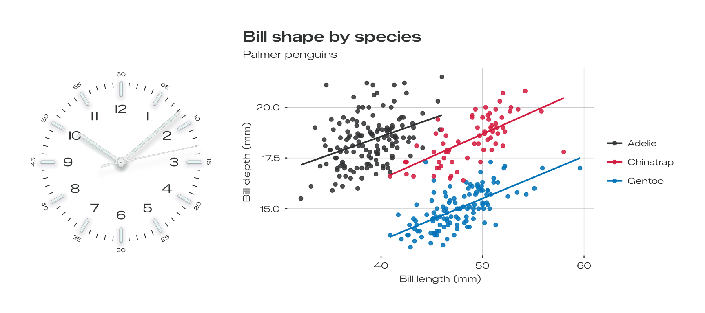

## Turquoise

`theme_bauhaus(“turquoise”)` · paper `#AFF2F1` · numerals `#004F5D` ·
track `#007C84` · grain σ 3.8

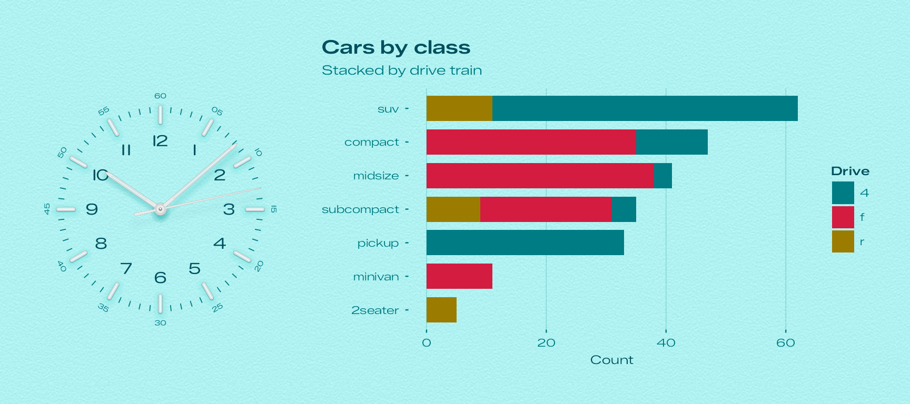

## Glacier

`theme_bauhaus(“glacier”)` · paper `#B1C5CD` · numerals `#1B3A49` ·
track `#2E5B73` · grain σ 4.8

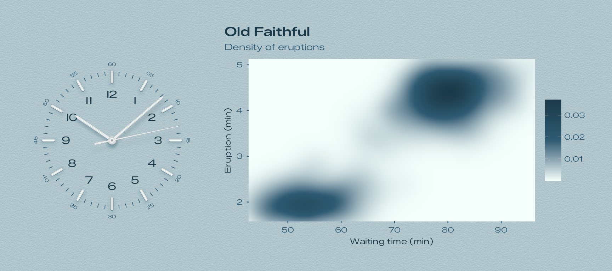

## Ocean

`theme_bauhaus(“ocean”)` · paper `#152D55` · numerals `#D4FFF0` · track
`#6AF4D9` · grain σ 5.3

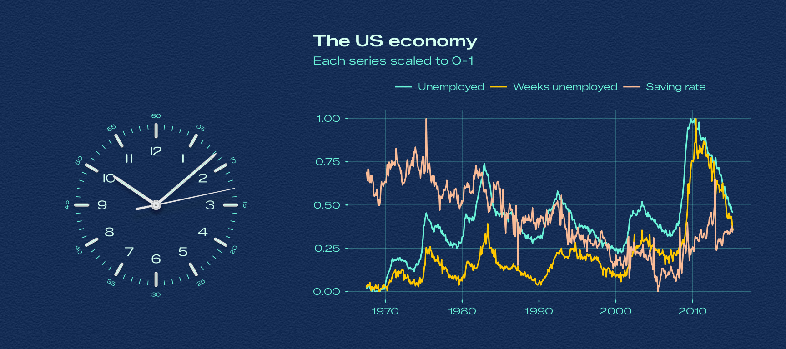

## Tennis

`theme_bauhaus(“tennis”)` · paper `#00824B` · numerals `#A7FF01` · track
`#45FFBB` · grain σ 7.8

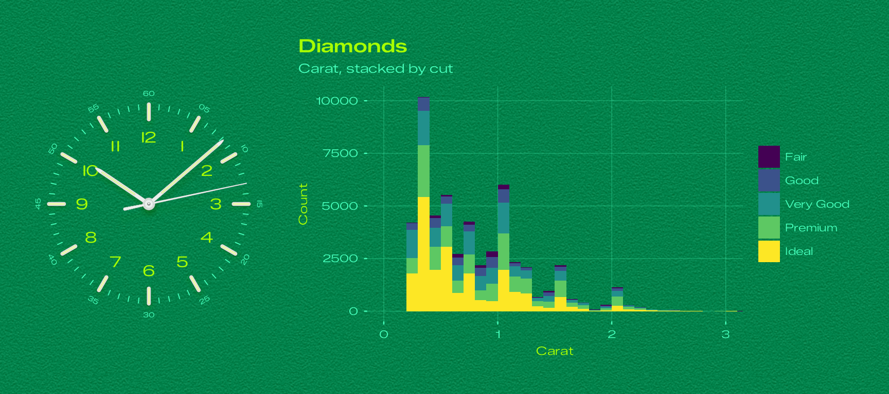

## Signal Blue

`theme_bauhaus(“signal_blue”)` · paper `#00AFEC` · numerals `#FFFFFF` ·
track `#9FFFFF` · grain σ 4

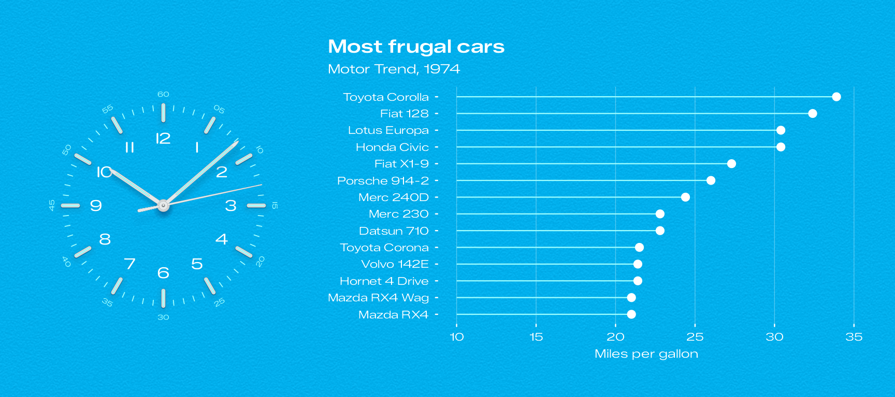

## Salmon

`theme_bauhaus(“salmon”)` · paper `#F9BB97` · numerals `#531A03` · track
`#4C1200` · grain σ 5.3

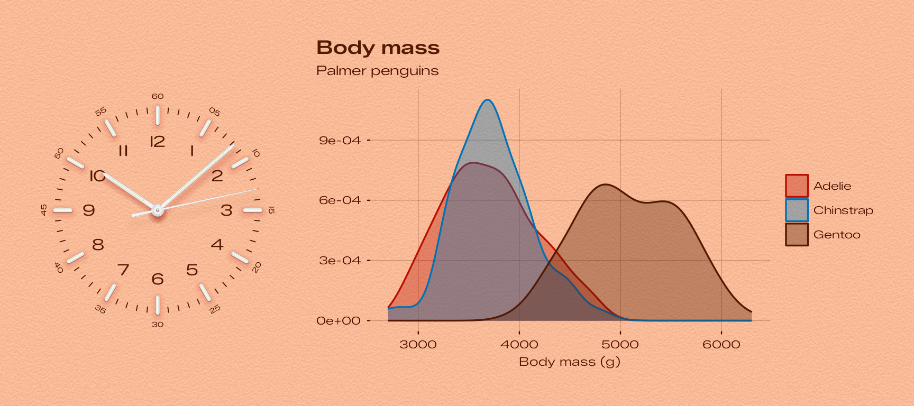

## Yellow

`theme_bauhaus(“yellow”)` · paper `#FFC800` · numerals `#4A0305` · track
`#6E2C00` · grain σ 4.5

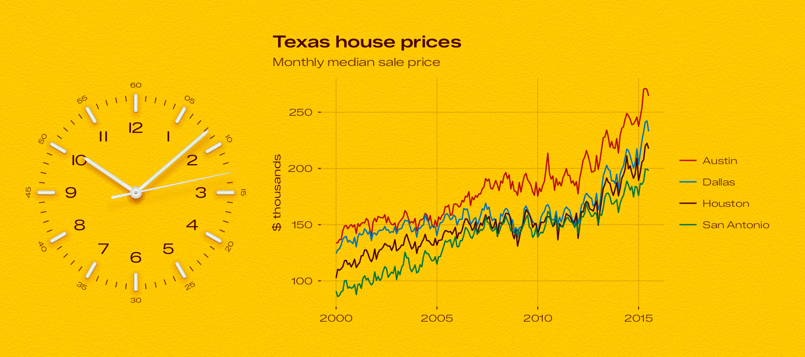

## Beige

`theme_bauhaus(“beige”)` · paper `#F1DAA6` · numerals `#4F3513` · track
`#856641` · grain σ 5.3

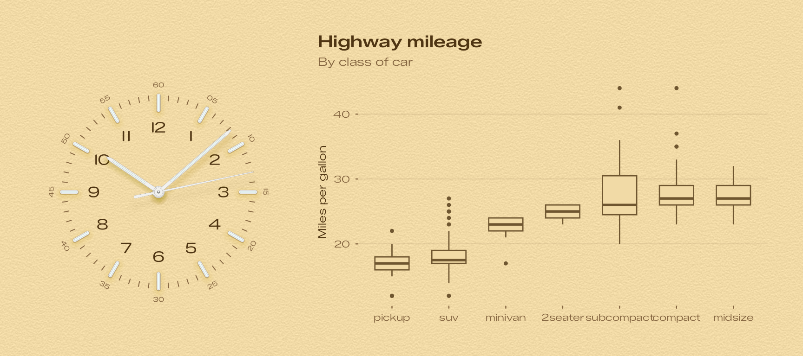

## Pistachio

`theme_bauhaus(“pistachio”)` · paper `#C0D2AD` · numerals `#233B13` ·
track `#364F2F` · grain σ 4.4

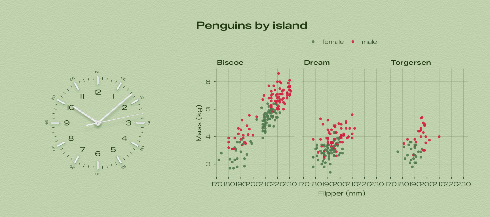

## Lavender

`theme_bauhaus(“lavender”)` · paper `#CFD6F5` · numerals `#364379` ·
track `#6570A6` · grain σ 4.7

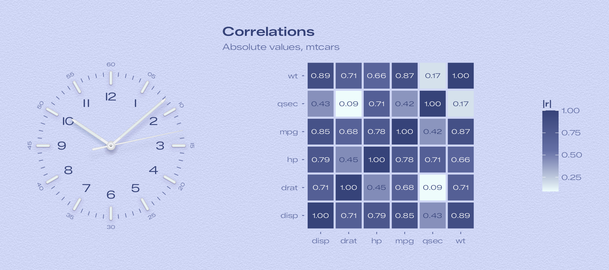

## Rose

`theme_bauhaus(“rose”)` · paper `#F9CCD8` · numerals `#68353C` · track
`#AF566C` · grain σ 4.4

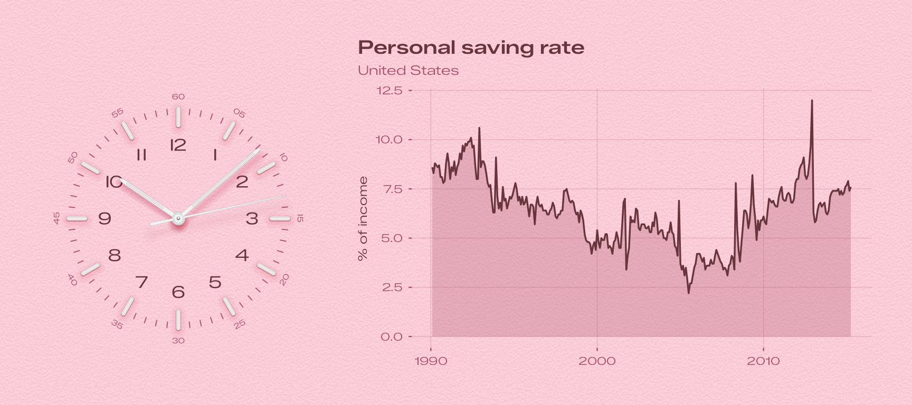

## Sky Blue

`theme_bauhaus(“sky_blue”)` · paper `#C0E7FF` · numerals `#194770` ·
track `#4D7EAE` · grain σ 4.3

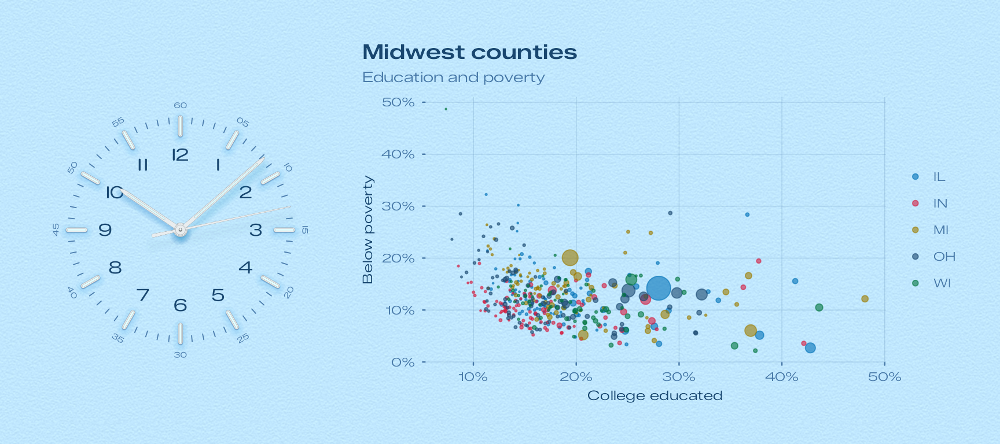

## Cream

`theme_bauhaus(“cream”)` · paper `#E8E6DF` · numerals `#545351` · track
`#B8B8B5` · grain σ 2.6

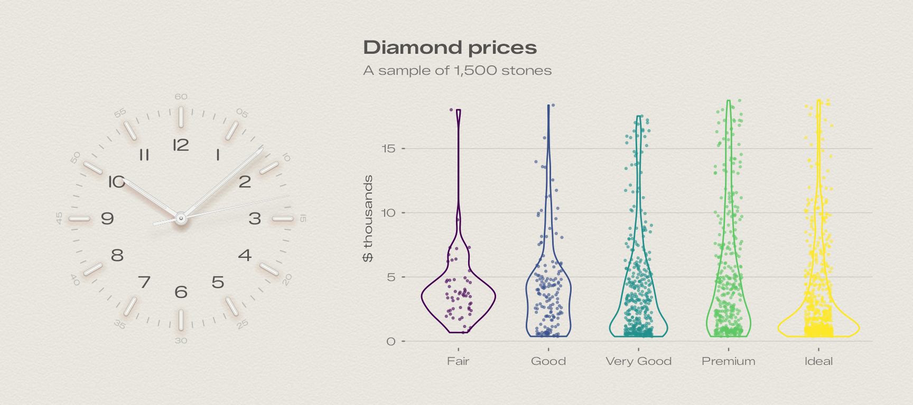

## Slate

`theme_bauhaus(“slate”)` · paper `#535457` · numerals `#F4FBFF` · track
`#7E8186` · grain σ 3.9

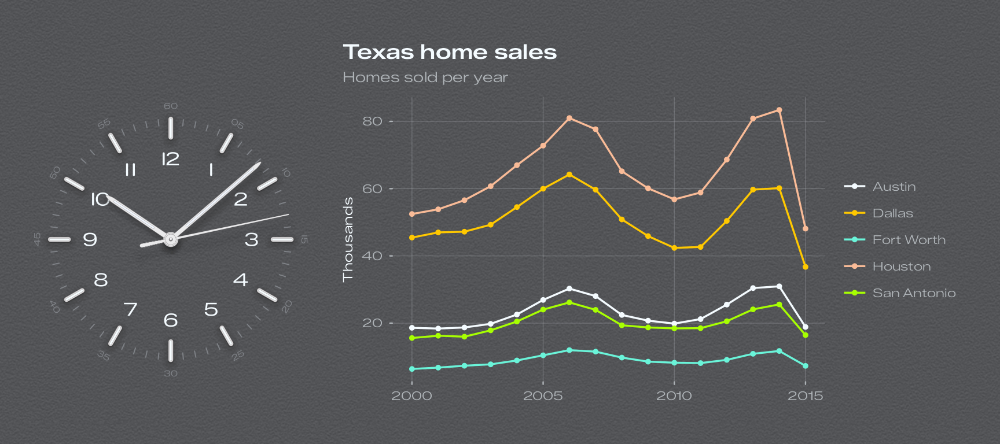

## Noir

`theme_bauhaus(“noir”)` · paper `#1B1B1C` · numerals `#E0E0DC` · track
`#9A9DA1` · grain σ 3.9

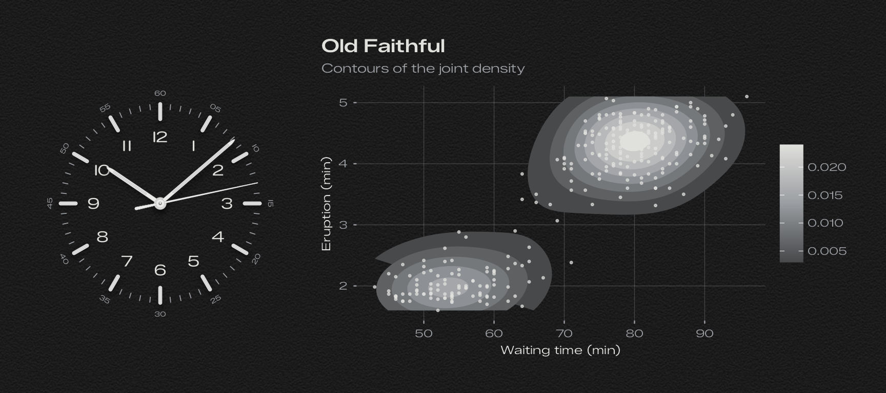

## The code

Each figure is the dial drawn by
[`bauhaus_clock()`](https://ashgreat.github.io/bauhaus-clock-ggplot/reference/bauhaus_clock.md)
next to a chart with the same theme, combined with patchwork:

``` r

knitr::opts_chunk$set(
  echo = FALSE,
  message = FALSE,
  warning = FALSE,
  dev = "ragg_png",
  fig.width = 9,
  fig.height = 4,
  out.width = "100%"
)
library(ggplot2)
library(bauhaus)
library(patchwork)

penguins <- na.omit(palmerpenguins::penguins)

# The dial on the left, a chart on the right, on one sheet of the dial's paper. Extra theme
# settings for the chart go in `...`.
showcase <- function(dial, chart, grid = "xy", ...) {
  clock <- bauhaus_clock(dial)
  chart <- chart + theme_bauhaus(dial, base_size = 10.5, grid = grid) + theme(...)
  (clock | chart) +
    plot_layout(widths = c(1, 1.45)) +
    plot_annotation(theme = theme_bauhaus(dial) + theme(plot.margin = margin(14, 14, 14, 14)))
}

dial_note <- function(dial) {
  d <- bauhaus_dials[bauhaus_dials$dial == dial, ]
  grain <- if (d$grain == 0) "no grain" else sprintf("grain &sigma; %.2g", d$grain)
  cat(sprintf(
    "<p><code>theme_bauhaus(\"%s\")</code> &middot; paper <code>%s</code> &middot; numerals <code>%s</code> &middot; track <code>%s</code> &middot; %s</p>\n",
    dial, d$paper, d$numeral, d$track, grain
  ))
}
```

The charts:

``` r

white <- ggplot(penguins, aes(bill_length_mm, bill_depth_mm, colour = species)) +
  geom_point(size = 1.4, alpha = 0.85) +
  geom_smooth(method = "lm", formula = y ~ x, se = FALSE, linewidth = 0.7) +
  labs(
    title = "Bill shape by species", subtitle = "Palmer penguins",
    x = "Bill length (mm)", y = "Bill depth (mm)", colour = NULL
  )
showcase("white", white)
by_count <- function(x) factor(x, levels = names(sort(table(x))))
turquoise <- ggplot(mpg, aes(y = by_count(class), fill = drv)) +
  geom_bar(width = 0.75) +
  labs(title = "Cars by class", subtitle = "Stacked by drive train", x = "Count", y = NULL, fill = "Drive")
showcase("turquoise", turquoise, grid = "x")
glacier <- ggplot(faithfuld, aes(waiting, eruptions, fill = density)) +
  geom_raster(interpolate = TRUE) +
  coord_cartesian(expand = FALSE) +
  labs(
    title = "Old Faithful", subtitle = "Density of eruptions",
    x = "Waiting time (min)", y = "Eruption (min)", fill = NULL
  )
showcase("glacier", glacier)
econ <- subset(economics_long, variable %in% c("psavert", "uempmed", "unemploy"))
econ$variable <- factor(econ$variable,
  levels = c("unemploy", "uempmed", "psavert"),
  labels = c("Unemployed", "Weeks unemployed", "Saving rate")
)
ocean <- ggplot(econ, aes(date, value01, colour = variable)) +
  geom_line(linewidth = 0.55) +
  labs(
    title = "The US economy", subtitle = "Each series scaled to 0-1",
    x = NULL, y = NULL, colour = NULL
  )
showcase("ocean", ocean, legend.position = "top")
tennis <- ggplot(diamonds, aes(carat, fill = cut)) +
  geom_histogram(binwidth = 0.1, boundary = 0) +
  coord_cartesian(xlim = c(0, 3)) +
  labs(title = "Diamonds", subtitle = "Carat, stacked by cut", x = "Carat", y = "Count", fill = NULL)
showcase("tennis", tennis)
cars <- mtcars[order(mtcars$mpg), ]
cars$model <- factor(rownames(cars), levels = rownames(cars))
cars <- tail(cars, 14)
signal_blue <- ggplot(cars, aes(mpg, model)) +
  geom_segment(aes(x = 10, xend = mpg, yend = model), linewidth = 0.4, colour = "#9FFFFF") +
  geom_point(size = 2.4) +
  labs(title = "Most frugal cars", subtitle = "Motor Trend, 1974", x = "Miles per gallon", y = NULL)
showcase("signal_blue", signal_blue, grid = "x")
salmon <- ggplot(penguins, aes(body_mass_g, fill = species, colour = species)) +
  geom_density(alpha = 0.35, linewidth = 0.6) +
  labs(title = "Body mass", subtitle = "Palmer penguins", x = "Body mass (g)", y = NULL, fill = NULL, colour = NULL)
showcase("salmon", salmon)
cities <- subset(txhousing, city %in% c("Austin", "Dallas", "Houston", "San Antonio"))
yellow <- ggplot(cities, aes(date, median / 1000, colour = city)) +
  geom_line(linewidth = 0.5) +
  labs(title = "Texas house prices", subtitle = "Monthly median sale price", x = NULL, y = "$ thousands", colour = NULL)
showcase("yellow", yellow)
beige <- ggplot(mpg, aes(reorder(class, hwy, median), hwy)) +
  geom_boxplot(width = 0.6, outlier.size = 0.9) +
  labs(title = "Highway mileage", subtitle = "By class of car", x = NULL, y = "Miles per gallon")
showcase("beige", beige, grid = "y")
pistachio <- ggplot(penguins, aes(flipper_length_mm, body_mass_g / 1000, colour = sex)) +
  geom_point(size = 1, alpha = 0.85) +
  facet_wrap(~island) +
  labs(title = "Penguins by island", x = "Flipper (mm)", y = "Mass (kg)", colour = NULL)
showcase("pistachio", pistachio, legend.position = "top")
r <- abs(cor(mtcars[, c("mpg", "disp", "hp", "drat", "wt", "qsec")]))
cors <- data.frame(x = rep(colnames(r), each = nrow(r)), y = rep(rownames(r), ncol(r)), r = as.vector(r))
lavender <- ggplot(cors, aes(x, y, fill = r)) +
  geom_tile(colour = bauhaus_colours("lavender")[["paper"]], linewidth = 1) +
  geom_text(
    aes(label = sprintf("%.2f", r), colour = I(ifelse(r > 0.55, "white", bauhaus_colours("lavender")[["numeral"]]))),
    size = 2.6, family = bauhaus_font_family()
  ) +
  coord_fixed() +
  labs(title = "Correlations", subtitle = "Absolute values, mtcars", x = NULL, y = NULL, fill = "|r|")
showcase("lavender", lavender, grid = "none")
rose <- ggplot(subset(economics, date > as.Date("1990-01-01")), aes(date, psavert)) +
  geom_area(alpha = 0.3, fill = bauhaus_colours("rose")[["track"]]) +
  geom_line(linewidth = 0.6) +
  labs(title = "Personal saving rate", subtitle = "United States", x = NULL, y = "% of income")
showcase("rose", rose)
sky_blue <- ggplot(midwest, aes(percollege, percbelowpoverty, size = poptotal, colour = state)) +
  geom_point(alpha = 0.6) +
  scale_size_area(max_size = 7, guide = "none") +
  scale_x_continuous(labels = function(x) paste0(x, "%")) +
  scale_y_continuous(labels = function(x) paste0(x, "%")) +
  labs(title = "Midwest counties", subtitle = "Education and poverty", x = "College educated", y = "Below poverty", colour = NULL)
showcase("sky_blue", sky_blue)
set.seed(1)
dsample <- diamonds[sample(nrow(diamonds), 1500), ]
cream <- ggplot(dsample, aes(cut, price / 1000, colour = cut)) +
  geom_violin(fill = NA, linewidth = 0.5, show.legend = FALSE) +
  geom_jitter(width = 0.15, size = 0.5, alpha = 0.5, show.legend = FALSE) +
  labs(title = "Diamond prices", subtitle = "A sample of 1,500 stones", x = NULL, y = "$ thousands")
showcase("cream", cream, grid = "y")
yearly <- aggregate(sales ~ year + city, data = subset(txhousing, city %in% c("Austin", "Dallas", "Houston", "Fort Worth", "San Antonio")), FUN = sum)
slate <- ggplot(yearly, aes(year, sales / 1000, colour = city)) +
  geom_line(linewidth = 0.6) +
  geom_point(size = 1.1) +
  labs(title = "Texas home sales", subtitle = "Homes sold per year", x = NULL, y = "Thousands", colour = NULL)
showcase("slate", slate)
noir <- ggplot(faithful, aes(waiting, eruptions)) +
  stat_density_2d(geom = "polygon", aes(fill = after_stat(level)), bins = 9) +
  geom_point(size = 0.6, alpha = 0.7) +
  labs(title = "Old Faithful", subtitle = "Contours of the joint density", x = "Waiting time (min)", y = "Eruption (min)", fill = NULL)
showcase("noir", noir)
```
