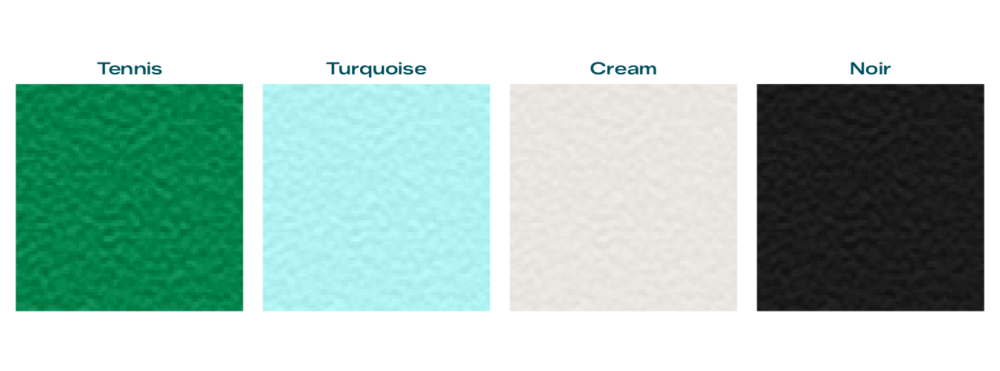
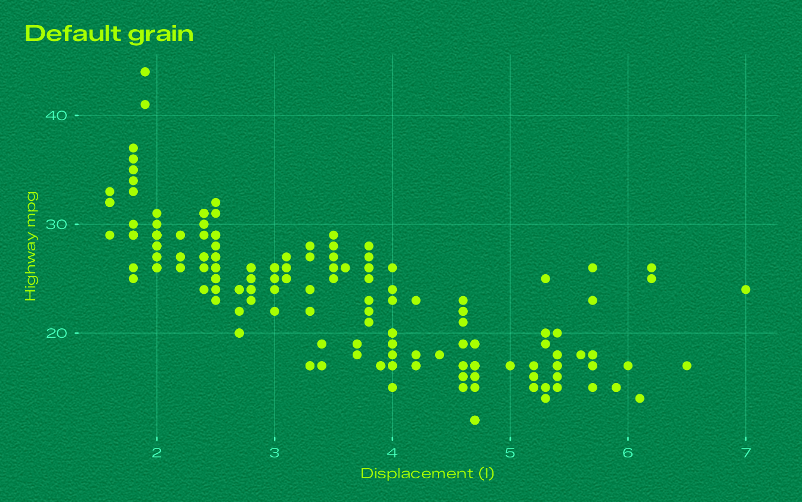
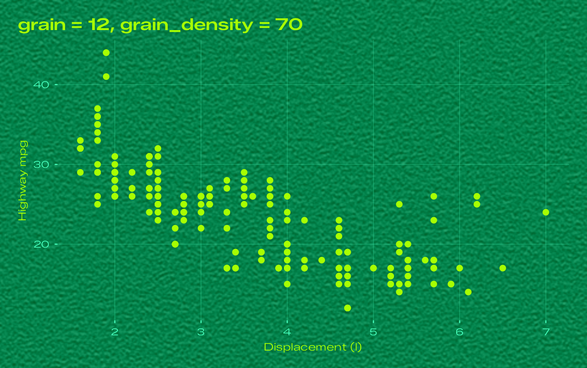
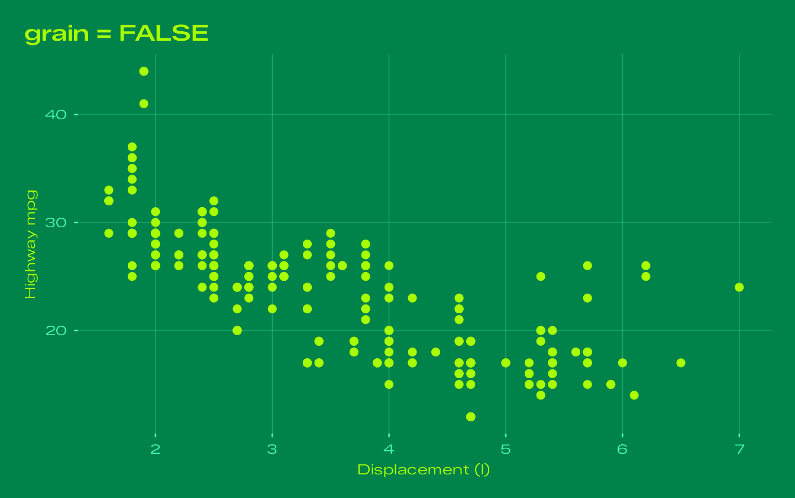
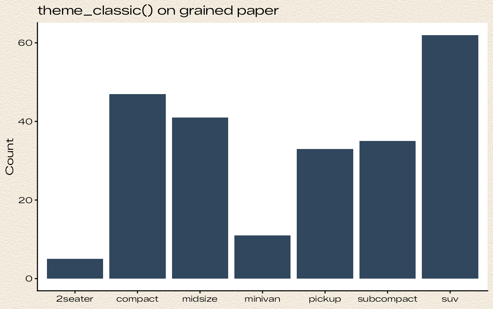
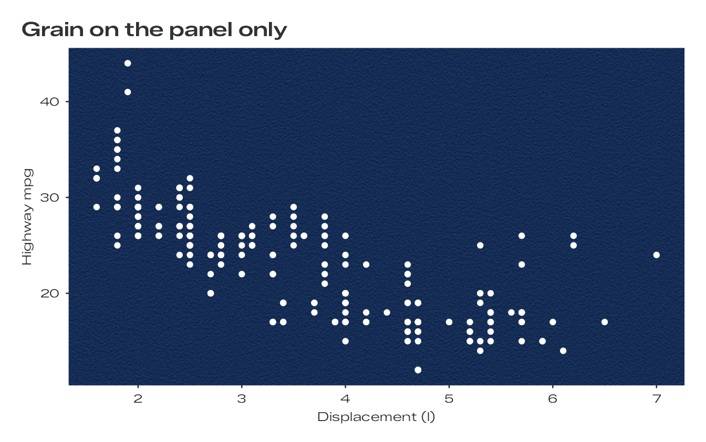
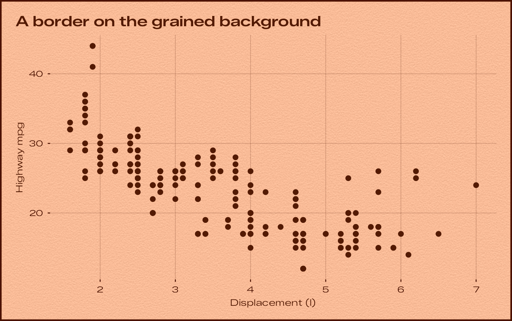

# The paper grain

The plates of the Bauhaus Clock screensaver are not flat fills. They
carry a fine paper grain, which is what keeps a coloured plate from
reading as a computer-drawn rectangle. bauhaus draws the same grain
behind your plots.

## How the grain is made

The grain is the screensaver’s own, generated the same way and from the
same seed:

1.  Uniform white noise from a 32-bit xorshift generator fills a
    seamless 512 x 512 tile.
2.  The noise is passed through a small 7 x 5 kernel measured from the
    original artwork. The kernel smooths along rows and sharpens across
    them, so the grain is made of short horizontal streaks, two to three
    samples long. There is no mottling, gradient, vignette or fibre.
3.  The result is scaled to unit variance and its tails are softened.
4.  For each dial, the plate colour is lifted by 13/255 and the grain is
    added equally to red, green and blue, at the strength measured for
    that dial.

The strengths, as standard deviations in 8-bit code values:

``` r

bauhaus_dials[order(bauhaus_dials$grain), c("name", "grain")]
#>           name grain
#> 1        White  0.00
#> 14       Cream  2.60
#> 2    Turquoise  3.80
#> 15       Slate  3.90
#> 16        Noir  3.90
#> 6  Signal Blue  4.00
#> 13    Sky Blue  4.30
#> 10   Pistachio  4.40
#> 12        Rose  4.40
#> 8       Yellow  4.45
#> 11    Lavender  4.70
#> 3      Glacier  4.80
#> 4        Ocean  5.30
#> 7       Salmon  5.30
#> 9        Beige  5.30
#> 5       Tennis  7.80
```

Up close, the grain on the Tennis dial looks like this (magnified eight
times):



## Grain in your plots

Every Bauhaus theme puts the grain on the plot background, using
[`element_grain()`](https://ashgreat.github.io/bauhaus-clock-ggplot/reference/element_grain.md).
Panels, legends and strips are left transparent, so the grain runs under
the whole plot, as it runs under the whole screen in the screensaver.

The grain is drawn at a fixed physical size, 150 samples per inch by
default, so it looks the same on a small figure and a poster. That
density matches the screensaver on a Retina laptop screen.

``` r

p <- ggplot(mpg, aes(displ, hwy)) +
  geom_point(size = 2) +
  labs(title = "Default grain", x = "Displacement (l)", y = "Highway mpg")

p + theme_bauhaus("tennis")
```



### Strength and size

`grain` sets the strength and `grain_density` the size:

``` r

p + labs(title = "grain = 12, grain_density = 70") +
  theme_bauhaus("tennis", grain = 12, grain_density = 70)
```



``` r

p + labs(title = "grain = FALSE") +
  theme_bauhaus("tennis", grain = FALSE)
```



### Grain on any background

[`element_grain()`](https://ashgreat.github.io/bauhaus-clock-ggplot/reference/element_grain.md)
is a rectangle element like
[`element_rect()`](https://ggplot2.tidyverse.org/reference/element.html),
so it can go anywhere a rectangle can, in any theme:

``` r

ggplot(mpg, aes(class)) +
  geom_bar(fill = "#30475E") +
  labs(title = "theme_classic() on grained paper", x = NULL, y = "Count") +
  theme_classic(base_family = bauhaus_font_family()) +
  theme(plot.background = element_grain(fill = "#F2EBDD", sigma = 6, colour = NA))
```



``` r

ggplot(mpg, aes(displ, hwy)) +
  geom_point(colour = "white") +
  labs(title = "Grain on the panel only", x = "Displacement (l)", y = "Highway mpg") +
  theme_bauhaus("white") +
  theme(panel.background = element_grain(fill = bauhaus_colours("ocean")[["paper"]], sigma = 5.3, colour = NA))
```



Adding a plain
[`element_rect()`](https://ggplot2.tidyverse.org/reference/element.html)
on top keeps the grain unless it sets a `fill`, so you can add a border
without losing the paper:

``` r

p + labs(title = "A border on the grained background") +
  theme_bauhaus("salmon") +
  theme(plot.background = element_rect(colour = bauhaus_colours("salmon")[["track"]], linewidth = 1.5))
```



## Files and devices

The grain is a raster image drawn when the plot is rendered, so it works
on every graphics device. In PNG, JPEG and TIFF files it costs very
little. In PDF and SVG files the raster makes the file larger; to draw
flat backgrounds everywhere, turn the grain off for the session:

``` r

options(bauhaus.grain = FALSE)
```

Very large outputs are capped at 25 million grain samples (set
`options(bauhaus.grain_max_samples = ...)` to change this); above that
the samples grow a little.
