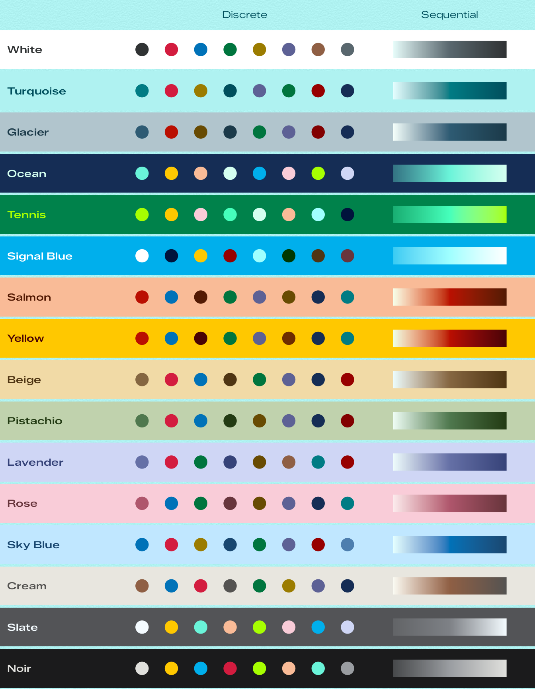
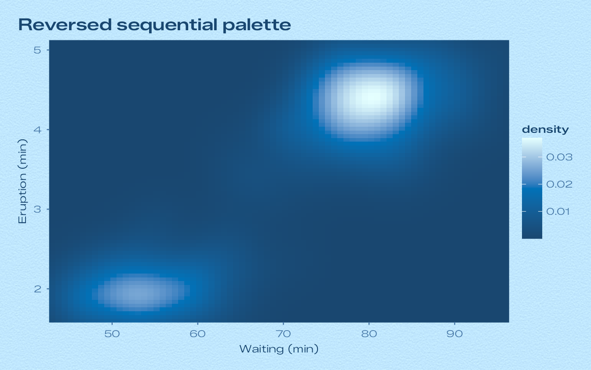
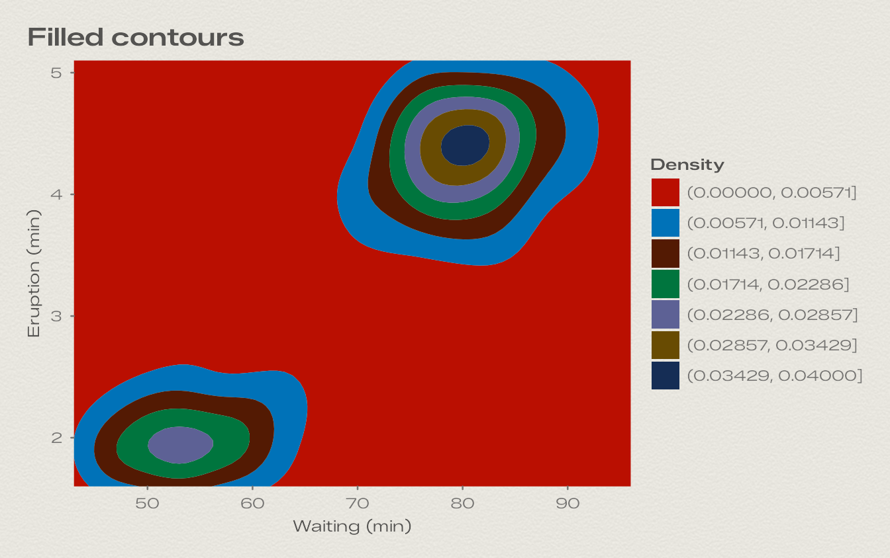
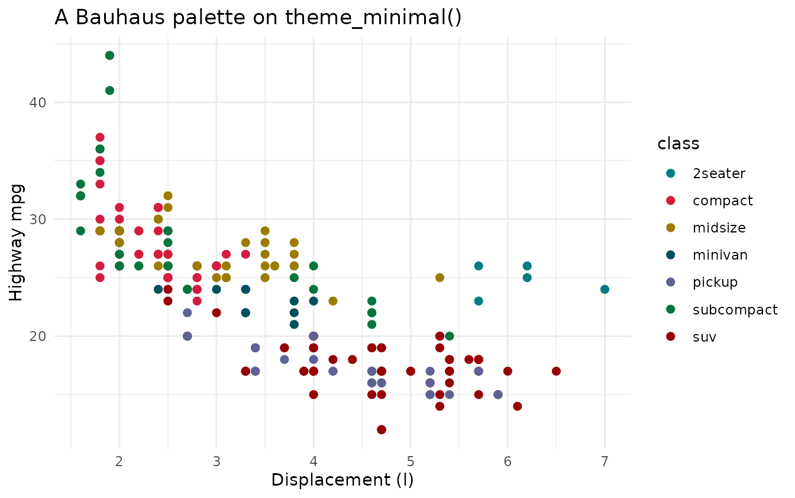
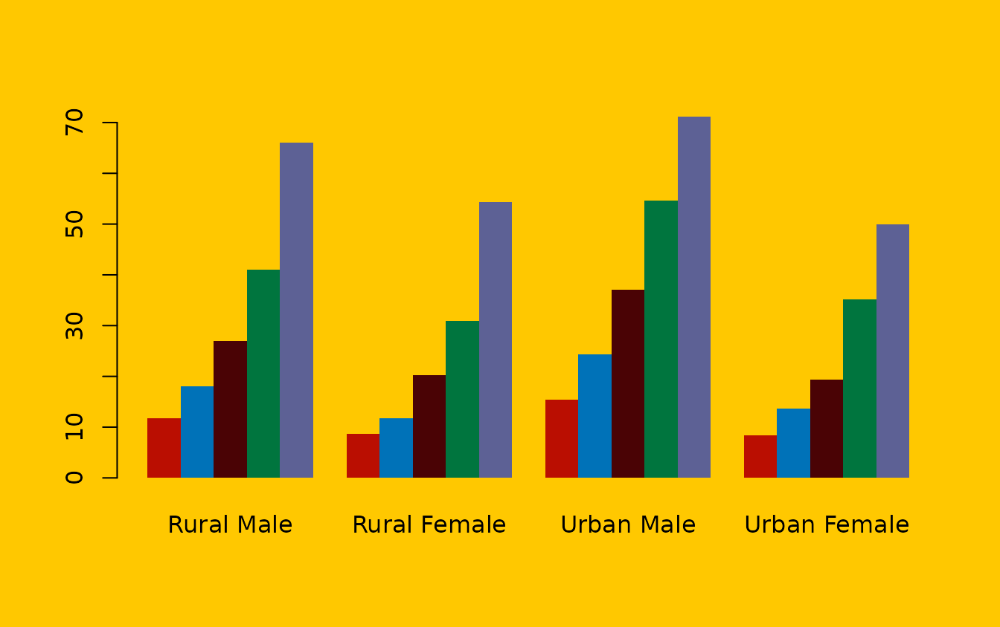

# Colours and palettes

## Where the colours come from

Each dial of the screensaver is a small colour system. Its colours were
measured from the dial artwork and are stored in `bauhaus_dials`:

- **paper** and **plate**: the plate as shown on screen (lifted by
  13/255) and its nominal colour.
- **numeral**: the hour numerals.
- **track**: the minute track and the minute numerals.
- **steel**, **hand** and **hub**: the polished steel of the indices,
  hands and hub.
- **lume** and **lume_hand**: the luminous paint in the indices and
  hands, by daylight.
- **shadow_core**, **shadow_ambient** and **shadow_contact**: the tinted
  shadows under the hands and indices. On coloured dials these are deep,
  saturated versions of the plate.

The palettes are built from these:

- The **discrete** palette has eight colours. It opens with the dial’s
  own signature colour and ink, then borrows accents from the other
  dials (their plates, inks and shadow tints), chosen to stand out
  against this dial’s plate. Apart from the dial’s own inks on the two
  mid-tone plates, Signal Blue and Tennis, the first six colours of
  every palette reach a contrast ratio of at least 3:1 against the
  paper.
- The **sequential** palette is a ramp of the dial’s own colours. On
  light dials it runs from the daylight lume through the signature
  colour to the numeral ink; on dark dials it rises from just above the
  plate through the track ink to the numeral ink.

## All palettes



## The colours of each dial

[TABLE]

Get any of them in R:

``` r

bauhaus_colours("signal_blue")
#>          paper          plate        numeral          track          steel 
#>      "#00AFEC"      "#00A2DF"      "#FFFFFF"      "#9FFFFF"      "#C3CCCE" 
#>           hand           lume      lume_hand            hub    shadow_core 
#>      "#C6CED1"      "#A7FFFF"      "#A1FEFB"      "#B9C2C3"      "#003C65" 
#> shadow_ambient shadow_contact 
#>      "#1D547E"      "#00133C"
bauhaus_palette("signal_blue")
#> [1] "#FFFFFF" "#00133C" "#FFC800" "#970000" "#9FFFFF" "#003700" "#4F3513"
#> [8] "#68353C"
bauhaus_palette("signal_blue", type = "sequential", n = 5)
#> [1] "#38CBF3" "#74E5F9" "#9FFFFF" "#D3FFFF" "#FFFFFF"
```

## Using the palettes

Inside a Bauhaus theme the dial’s palettes are already the defaults.
Scales let you use another dial’s palette, reverse it, or bin it:

``` r

ggplot(faithfuld, aes(waiting, eruptions, fill = density)) +
  geom_raster() +
  scale_fill_bauhaus_c("sky_blue", reverse = TRUE) +
  coord_cartesian(expand = FALSE) +
  labs(title = "Reversed sequential palette", x = "Waiting (min)", y = "Eruption (min)") +
  theme_bauhaus("sky_blue")
```



``` r

ggplot(faithfuld, aes(waiting, eruptions, z = density)) +
  geom_contour_filled(bins = 7) +
  scale_fill_bauhaus_d("salmon") +
  coord_cartesian(expand = FALSE) +
  labs(title = "Filled contours", x = "Waiting (min)", y = "Eruption (min)", fill = "Density") +
  theme_bauhaus("cream")
```



They work with other themes as well:

``` r

ggplot(mpg, aes(displ, hwy, colour = class)) +
  geom_point(size = 2) +
  scale_colour_bauhaus_d("turquoise") +
  labs(title = "A Bauhaus palette on theme_minimal()", x = "Displacement (l)", y = "Highway mpg") +
  theme_minimal()
```



The discrete palettes stop at eight colours, because more categories
than that are hard to tell apart. With more groups, ggplot2 warns and
leaves the extra ones grey; consider lumping the smallest groups
together.

For base graphics, use the colour vectors directly:

``` r

op <- par(bg = bauhaus_colours("yellow")[["paper"]], family = "sans")
barplot(VADeaths, beside = TRUE, col = bauhaus_palette("yellow", n = 5), border = NA)
```



``` r

par(op)
```
